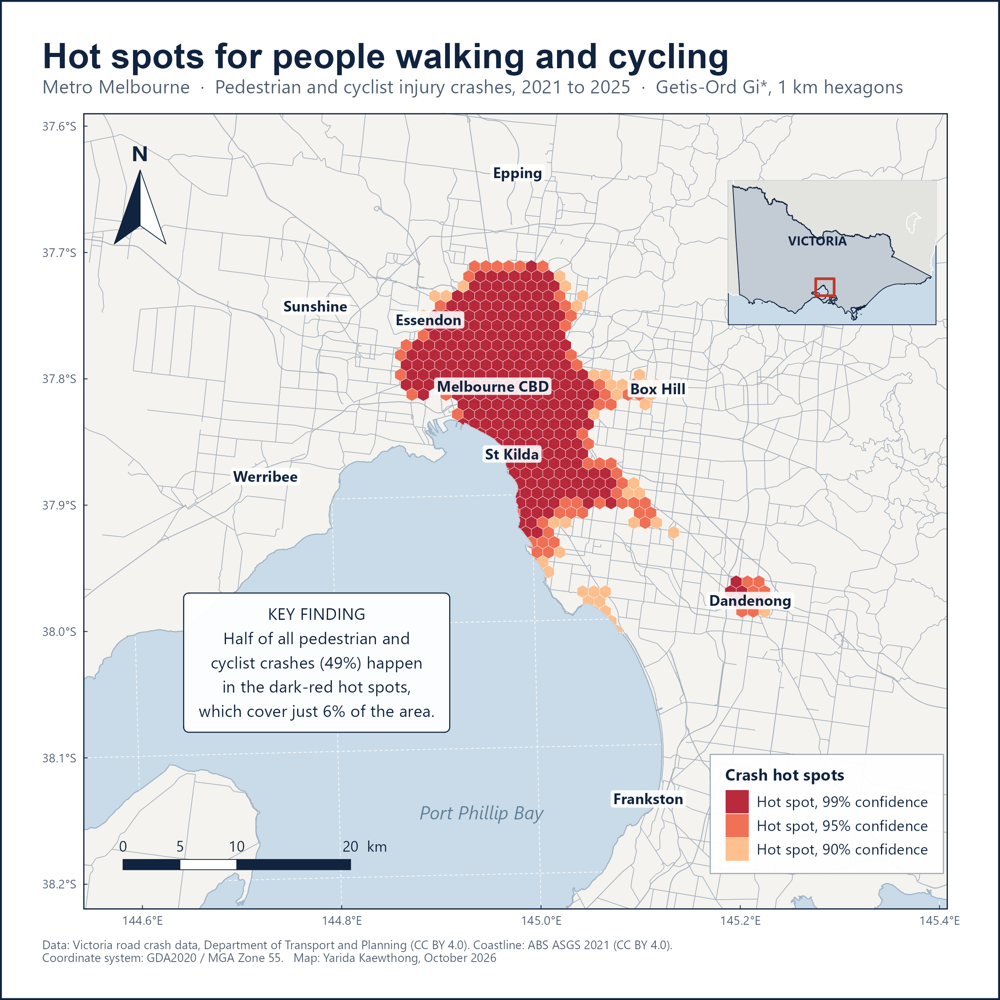

# Walking and Cycling Safety in Melbourne

**Where and when are people walking and cycling most at risk?**
An R and GIS analysis of 14 years of real Victorian road crash records, 2012 to 2025.

🌐 **Full write-up with interactive charts:** [yarida-cv.vercel.app/melbourne-crash.html](https://yarida-cv.vercel.app/melbourne-crash.html)

## Key findings

- **Half the crashes happen in 6% of the area.** Getis-Ord Gi* on a 1 km hexagon grid found 273 statistically significant (99%) hot spots, holding 49% of 2021–2025 pedestrian and cyclist crashes. They cluster in the City of Melbourne, Yarra and Port Phillip, with a separate cluster in Dandenong.
- **Faster roads, worse injuries.** The share of pedestrian crashes that killed or seriously injured someone rises from **41% in 40 km/h zones to 65% in 80+ km/h zones** (χ² test for trend = 274.9, p < 0.001).
- **Darkness makes it worse:** 46% serious in daylight, 56% in the dark with street lights, 63% without them.
- **Different timing for different users:** cyclist crashes peak at 8 am on weekdays, pedestrian crashes around 3 pm.
- **Dooring** (riding into a car door) is 11% of all cyclist crashes.

## What's in this repo

| Path | What it is |
|---|---|
| `melbourne_vru_analysis.R` | The full analysis: cleaning, trend, timing, severity with confidence intervals, Gi* hot spots, exports |
| `melbourne_layout_maps.R` | Print-style map layouts (north arrow, scale bar, legend, locator map) |
| `findings_note.md` | One-page summary of results and recommendations |
| `outputs/` | Charts, maps and result tables |
| `gis_layers/` | Hot-spot hexagons, crash points and roads as GeoPackages, ready for QGIS or ArcGIS |
| `powerbi/` | Clean table, colour theme and a step-by-step guide for a Power BI dashboard |
| `QGIS_STEPS.md`, `ARCGIS_STEPS.md` | Guides for rebuilding the map in desktop GIS |

## Run it yourself

1. Download these files into `data_raw/` (they are too large to store here):
   - `victorian_road_crash_data.csv` from [Victoria road crash data](https://opendata.transport.vic.gov.au/dataset/victoria-road-crash-data)
   - `yearly_aadt_volume_2019.geojson` from [Historical Annual Average Daily Traffic Volume](https://opendata.transport.vic.gov.au/dataset/historical-annual-average-daily-traffic-volume)
   - `STE_2021_AUST_SHP_GDA2020.zip` from the [ABS ASGS Edition 3 boundaries](https://www.abs.gov.au/statistics/standards/australian-statistical-geography-standard-asgs-edition-3/jul2021-jun2026/access-and-downloads/digital-boundary-files), unzipped into `data_raw/ste/`
2. In R, install the packages: `install.packages(c("sf", "dplyr", "tidyr", "readr", "ggplot2", "scales", "ragg", "cowplot"))`
3. Set the working directory to this folder and run `melbourne_vru_analysis.R`, then `melbourne_layout_maps.R`.

## Data and licence

- Crash and traffic data: Department of Transport and Planning, Victoria, CC BY 4.0
- Boundaries: Australian Bureau of Statistics, CC BY 4.0
- Injury and fatal crashes only. There is no measure of how many people walk or cycle in each area, so hot spots partly reflect where people travel most.

**Author:** Yarida Kaewthong · [Portfolio](https://yarida-cv.vercel.app) · [LinkedIn](https://www.linkedin.com/in/yarida-kaewthong)
